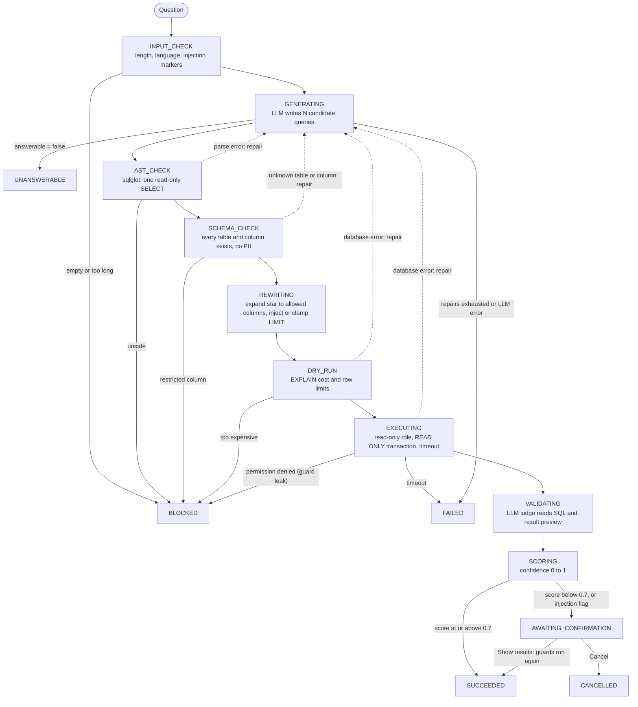

# Guarded Text-to-SQL

Ask a PostgreSQL database questions in plain English or Bangla, without trusting the SQL an LLM writes.

The LLM only ever produces text. Python code parses that text, checks it against four independent
safety layers and runs it under a read-only database role. Every answer comes with the SQL that
produced it, a confidence score and the full guard history. Uncertain answers are held until a
person confirms them.

<!-- Demo GIF: normal question -> low-confidence confirmation -> blocked injection -> unanswerable question -->

## The problem

Text-to-SQL is useful because it lets people who don't write SQL query a database. It is also
risky, because the model's output is code that runs against your data:

- a model can be talked into `DROP`, `DELETE` or `pg_sleep` through the question itself, or through
  instructions hidden in the data it reads back;
- it can invent tables and columns that don't exist;
- it can read columns it should never see (emails, phone numbers, password hashes);
- it can return a confident, well-formatted answer to a slightly different question.

Prompt instructions alone don't fix any of this. This project treats every piece of generated SQL
as untrusted input. It parses and checks the SQL before anything reaches the database, assumes any
single check can fail, and tells the user how far to trust each answer.

## How a question is answered

Every question becomes one logged run that moves through a checked state machine:



Rules that hold across the pipeline:

- **BLOCKED is never retried or repaired.** Sending an unsafe query back to the model would let it
  learn its way around the guard. Only honest mistakes (a parse error, an unknown column, a
  database error) are repaired, at most twice per run.
- **Only SQL rebuilt from the checked syntax tree executes.** The model's raw text never reaches the
  database.
- **Self-consistency.** Several candidates are generated in parallel. If any candidate is unsafe,
  the whole run is BLOCKED, because an unsafe candidate is an attack signal.
- **Everything is logged:** each state transition, each guard decision per candidate, every LLM
  call with tokens and cost. That includes blocked and failed runs.

## Safety layers

| Layer | What it stops | How it is tested |
|---|---|---|
| Input check | Empty or over-long questions. Injection markers ("ignore previous instructions", SQL statements, `pg_sleep`, our own prompt tags, in English and Bangla) set a `possible_injection` flag, so the answer always needs confirmation. | Runner tests: empty and over-long questions are BLOCKED; flagged questions (English and Bangla) are never shown without confirmation |
| 1. AST checks (sqlglot) | Anything other than one `SELECT` / non-recursive `WITH ... SELECT`: DDL, DML, data-modifying CTEs, stacked statements, `SELECT INTO`, `FOR UPDATE`, `WITH RECURSIVE`, system catalogs, other schemas, functions outside an allowlist | 140 tests, including comment smuggling, nested comments, `EXPLAIN`-wrapped writes and functions hidden in nested expressions |
| 2. Schema and hallucination checks | Tables or columns that don't exist (sent back for repair). Restricted PII columns (`customer.email`, `address.phone`, `staff.password` and others) and whole-row references, also when reached through an alias, subquery or CTE, are BLOCKED and never repaired. `*` expands to allowlisted columns only. | 70 schema tests and 40 rewrite tests; the rewritten SQL is checked by layer 1 again |
| 3. EXPLAIN dry run | Queries whose plan exceeds a cost or row limit in **any** plan node (an injected `LIMIT` hides the cost at the root): cross-join bombs, full scans of huge joins | 16 tests against the real database |
| 4. Read-only execution | A dedicated role with column-level `SELECT` grants on allowlisted columns only, `default_transaction_read_only`, a `READ ONLY` transaction, a statement timeout and the extended query protocol (no second statement). A permission error here means an earlier layer leaked: the run is BLOCKED and a critical event is logged. | 18 execution tests and 38 role tests that run writes, DDL, `pg_sleep`, file reads, restricted columns and other databases directly as that role, and check the grants match the allowlist |
| Output | Row values can contain text that looks like instructions. The judge prompt treats them as data. The UI renders everything with `textContent` under a strict Content Security Policy. | API tests with `<script>` and `onerror` payloads in row values; UI tests that forbid HTML sinks and inline scripts |

On top of the unit tests there is an adversarial set of 45 attacks (35 English, 10 Bangla) covering
destructive SQL, stacked statements, resource abuse, data exfiltration, prompt injection in the
question and in the data, comment smuggling and PII requests. Each attack has the SQL a fooled
model might write. That SQL goes through the real guards offline and must be BLOCKED by the
expected rule, and the full attack runs live through the pipeline in the eval suite.

## Confidence and confirmation

After execution, a second LLM call (the judge) reads the question, the SQL and a preview of the
result, and decides whether it answers the question: `yes`, `partial` or `no`. It is strict: an
extra column or a wrongly formatted value counts as `partial`. The score combines four signals,
with weights set in config:

| Signal | Weight |
|---|---|
| Judge verdict (yes 1, partial 0.5, no 0) | 0.65 |
| Self-consistency (candidates returning the same result) | 0.15 |
| Repairs needed | 0.10 |
| Result sanity (unexpectedly empty, or cut off by an injected LIMIT) | 0.10 |

At 0.7 or above, results are shown directly. Below 0.7, or when the question was flagged for
possible injection, the run waits in AWAITING_CONFIRMATION. The SQL is shown, but rows are not
stored or returned. **Show results** re-runs the stored SQL through the dry run and read-only
execution again (no new LLM call); **Cancel** ends the run.

## Evaluation results

Latest full run: [`evals/reports/2026-10-29-8fa68240.md`](evals/reports/2026-10-29-8fa68240.md).
It used 52 golden questions (40 English, 12 Bangla) with hand-checked expected results, and the 45
adversarial attacks.

| Metric | Result | Target |
|---|---|---|
| Execution accuracy (golden) | **98.1%** (51/52; English 97.5%, Bangla 100%) | at least 80% |
| Adversarial block rate | **100%** (45/45) | 100% |
| Unsafe executions (attack SQL that reached the database) | **0** | 0 |
| Layer leaks (attacks stopped only by database permissions) | **0** | 0 |
| False-block rate (golden questions refused) | **0%** | at most 5% |
| High-confidence answers that were correct | **100%** (50/50) | at least 90% |
| p50 latency, end to end | 4.4 s (golden only: 5.8 s) | under 6 s |
| p95 latency, end to end | 51.9 s | (see below) |
| Cost | $0 on the free tier; $0.0017 per question at list prices | |

Calibration on the golden set:

| Confidence | Correct |
|---|---|
| 0.00 to 0.50 | 1/1 |
| 0.50 to 0.70 | 0/1 |
| 0.70 to 0.85 | 0/0 |
| 0.85 to 1.00 | 50/50 |

The one wrong answer (a "which day of the week" question answered with an extra count column and a
space-padded day name) scored 0.675 and was held for confirmation instead of being shown.

**About latency:** these numbers were measured on the **Gemini free tier**, with
`gemini-3.5-flash-lite` as both generator and judge, and are reported as measured. Each question
makes three LLM calls (two candidates and one judge), and the client caps itself at 10 requests per
minute to stay inside free-tier limits. When questions run back to back, roughly one in four waits
for that window. That wait is the 50-second p95. Without those waits, p95 is about 8.5 s. The
latency target is meant for a paid tier.

**Known weakness:** the judge sometimes relies on what it remembers about the public Pagila dataset
instead of the data it is shown. In one Bangla case it called a correct answer wrong. The error is
on the safe side: that answer needed confirmation instead of being shown directly.

## Quickstart

Prerequisites:

- [Docker](https://docs.docker.com/get-docker/) with Compose
- [uv](https://docs.astral.sh/uv/) (it installs Python 3.12 for you)
- an API key for [Gemini](https://aistudio.google.com/apikey) (the free tier works) or
  [Anthropic](https://console.anthropic.com/)

```bash
git clone https://github.com/rafiqulexe/guarded-text-to-sql.git
cd guarded-text-to-sql
cp .env.example .env
```

Put your key in `.env`: `GEMINI_API_KEY=...`. For Anthropic, also set `LLM_PROVIDER=anthropic`,
`ANTHROPIC_API_KEY`, `GEN_MODEL` and `JUDGE_MODEL`; the comments in `.env.example` list suitable
models. The database passwords in `.env.example` are local development defaults; change them
(and `db/init/03_roles.sql`) before exposing the database anywhere.

```bash
docker compose up -d            # Postgres 18 with Pagila, the read-only role and the app database
uv sync                         # install dependencies
uv run alembic upgrade head     # create the app tables (runs, guard events, evals)
uv run uvicorn app.main:app --reload
```

Open <http://127.0.0.1:8000> and ask, for example, "Which 5 films were rented the most?" or
"ক্যাটালগে মোট কতগুলো ফিল্ম আছে?". `GET /health` reports whether both databases are reachable
and whether a key is configured, without returning the key or connection details.

The first `docker compose up` loads the Pagila data, which takes a little while. To start from a
clean database, run `docker compose down -v && docker compose up -d`.

### API

| Route | Purpose |
|---|---|
| `POST /api/ask` | `{"question": "...", "run_id": "<optional uuid>"}` runs the pipeline and returns the run with SQL, rows, confidence and guard history |
| `GET /api/runs/{id}` | The run so far; the UI polls it to show live progress |
| `POST /api/runs/{id}/confirm` | Show results for a run in AWAITING_CONFIRMATION (409 in any other state) |
| `POST /api/runs/{id}/cancel` | Cancel a run in AWAITING_CONFIRMATION |
| `GET /api/runs?limit=` | Recent runs |
| `GET /health` | Database and configuration status |

## Tests and evals

```bash
uv run pytest -q                # 800+ tests; the LLM is always mocked
uv run ruff check . && uv run mypy
```

Tests that need the database are skipped when Docker is not running.

```bash
uv run python -m evals.golden        # every golden query reproduces its stored result hash (no LLM)
uv run python -m evals.adversarial   # every attack's SQL is BLOCKED by its expected rule (no LLM)
uv run python -m evals.run           # full live eval through the pipeline (uses your API quota)
```

`evals.run` runs cases one at a time and stores each result as it finishes. Its options:
`--suite golden|adversarial`, `--limit N`, `--case ID`, `--resume [EVAL_RUN_ID]` to continue an
interrupted run, and `--retry-failed` to re-run cases that failed on provider errors. It writes a
Markdown report to `evals/reports/`.

## Project structure

```
app/
  main.py              FastAPI routes, security headers
  pipeline/            runner (state machine), ast_guard, schema_guard, rewrite, dry_run,
                       execute, generate, validate (judge), score, consistency, llm client
  prompts/             generation, repair and judge prompts
  templates/, static/  single-page UI (plain HTML, CSS, JS)
db/
  allowlist.yaml       tables, columns, restricted columns and functions the model may use
  gen_grants.py        generates the read-only role's grants from the allowlist
  init/                Pagila schema and data, roles (run by Postgres on first start)
migrations/            Alembic migrations for the app database
evals/                 golden and adversarial sets, eval runner, reports
tests/                 unit, database and API tests
scripts/               live checks against the real LLM provider
```

After editing `db/allowlist.yaml`, run `uv run python db/gen_grants.py` to regenerate
`db/init/03_roles.sql`. The allowlist and the database grants must always agree.

## License

[MIT](LICENSE).

### Credits

The [Pagila](https://github.com/devrimgunduz/pagila) sample database (v4.1.1) in
`db/init/01_pagila_schema.sql` and `db/init/02_pagila_data.sql` is third-party work, distributed
under the PostgreSQL License. It is not covered by this project's MIT license.
